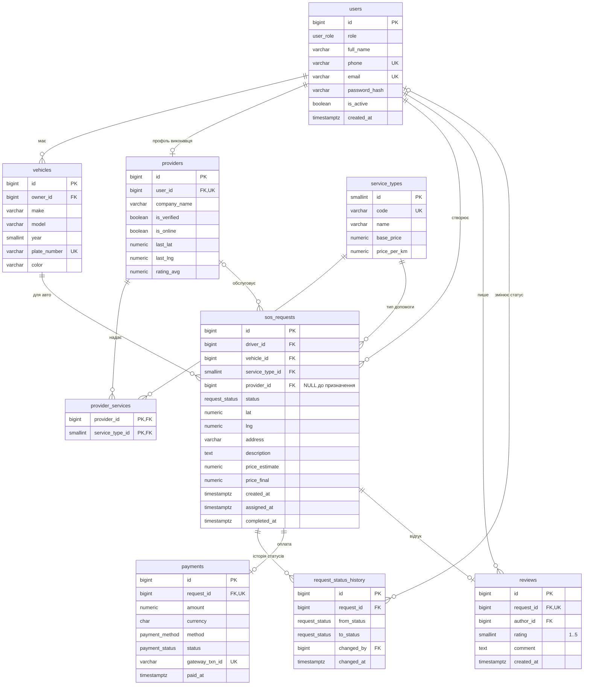

# 1-ERD

Модель даних DriveSOS має 9 таблиць. Центральна сутність — `sos_requests`: водій створює заявку, система призначає виконавця, після завершення йдуть оплата і відгук. СУБД — PostgreSQL.

## Діаграма



## Зв'язки

| Зв'язок | Кардинальність | Реалізація | Зміст |
| --- | --- | --- | --- |
| users → vehicles | 1 : N | `vehicles.owner_id` FK | Водій має кілька авто |
| users → providers | 1 : 0..1 | `providers.user_id` FK UNIQUE | Профіль виконавця для ролі provider |
| providers ↔ service_types | M : N | таблиця `provider_services` | Які послуги надає виконавець |
| users → sos_requests | 1 : N | `sos_requests.driver_id` FK | Водій створює заявки |
| vehicles → sos_requests | 1 : N | `sos_requests.vehicle_id` FK | Заявка стосується одного авто |
| service_types → sos_requests | 1 : N | `sos_requests.service_type_id` FK | Тип потрібної допомоги |
| providers → sos_requests | 1 : N | `sos_requests.provider_id` FK, NULL до призначення | Виконавець обслуговує заявки |
| sos_requests → request_status_history | 1 : N | `request_status_history.request_id` FK | Аудит змін статусу |
| sos_requests → payments | 1 : 0..1 | `payments.request_id` FK UNIQUE | Одна оплата на заявку |
| sos_requests → reviews | 1 : 0..1 | `reviews.request_id` FK UNIQUE | Один відгук на заявку |
| users → reviews | 1 : N | `reviews.author_id` FK | Автор відгуку |
| users → request_status_history | 1 : N | `request_status_history.changed_by` FK | Хто змінив статус |

Схема в 3НФ: ціни послуг зберігаються лише в `service_types`, а в заявці — тільки зафіксовані `price_estimate` і `price_final`.

## SQL DDL

```sql
CREATE TYPE user_role      AS ENUM ('driver','provider','admin');
CREATE TYPE request_status AS ENUM ('created','searching','assigned','en_route','in_progress','completed','cancelled');
CREATE TYPE payment_method AS ENUM ('card','cash');
CREATE TYPE payment_status AS ENUM ('pending','paid','failed','refunded');

CREATE TABLE users (
  id            BIGSERIAL PRIMARY KEY,
  role          user_role    NOT NULL,
  full_name     VARCHAR(120) NOT NULL,
  phone         VARCHAR(20)  NOT NULL UNIQUE,
  email         VARCHAR(255) UNIQUE,
  password_hash VARCHAR(255) NOT NULL,
  is_active     BOOLEAN      NOT NULL DEFAULT TRUE,
  created_at    TIMESTAMPTZ  NOT NULL DEFAULT now()
);

CREATE TABLE vehicles (
  id           BIGSERIAL PRIMARY KEY,
  owner_id     BIGINT      NOT NULL REFERENCES users(id) ON DELETE CASCADE,
  make         VARCHAR(50) NOT NULL,
  model        VARCHAR(50) NOT NULL,
  year         SMALLINT CHECK (year BETWEEN 1950 AND 2100),
  plate_number VARCHAR(15) NOT NULL UNIQUE,
  color        VARCHAR(30)
);

CREATE TABLE providers (
  id           BIGSERIAL PRIMARY KEY,
  user_id      BIGINT  NOT NULL UNIQUE REFERENCES users(id),
  company_name VARCHAR(120),
  is_verified  BOOLEAN NOT NULL DEFAULT FALSE,
  is_online    BOOLEAN NOT NULL DEFAULT FALSE,
  last_lat     NUMERIC(9,6),
  last_lng     NUMERIC(9,6),
  rating_avg   NUMERIC(2,1) NOT NULL DEFAULT 0
);

CREATE TABLE service_types (
  id           SMALLSERIAL PRIMARY KEY,
  code         VARCHAR(30)   NOT NULL UNIQUE,  -- tow, tire, fuel, battery, unlock
  name         VARCHAR(80)   NOT NULL,
  base_price   NUMERIC(10,2) NOT NULL CHECK (base_price >= 0),
  price_per_km NUMERIC(10,2) NOT NULL DEFAULT 0
);

CREATE TABLE provider_services (
  provider_id     BIGINT   NOT NULL REFERENCES providers(id) ON DELETE CASCADE,
  service_type_id SMALLINT NOT NULL REFERENCES service_types(id),
  PRIMARY KEY (provider_id, service_type_id)
);

CREATE TABLE sos_requests (
  id              BIGSERIAL PRIMARY KEY,
  driver_id       BIGINT   NOT NULL REFERENCES users(id),
  vehicle_id      BIGINT   NOT NULL REFERENCES vehicles(id),
  service_type_id SMALLINT NOT NULL REFERENCES service_types(id),
  provider_id     BIGINT   REFERENCES providers(id),
  status          request_status NOT NULL DEFAULT 'created',
  lat             NUMERIC(9,6) NOT NULL,
  lng             NUMERIC(9,6) NOT NULL,
  address         VARCHAR(255),
  description     TEXT,
  price_estimate  NUMERIC(10,2),
  price_final     NUMERIC(10,2),
  created_at      TIMESTAMPTZ NOT NULL DEFAULT now(),
  assigned_at     TIMESTAMPTZ,
  completed_at    TIMESTAMPTZ,
  CHECK (status IN ('created','searching','cancelled') OR provider_id IS NOT NULL)
);
CREATE INDEX ix_sos_requests_status ON sos_requests(status);
CREATE INDEX ix_sos_requests_driver ON sos_requests(driver_id, created_at DESC);

CREATE TABLE request_status_history (
  id          BIGSERIAL PRIMARY KEY,
  request_id  BIGINT NOT NULL REFERENCES sos_requests(id) ON DELETE CASCADE,
  from_status request_status,
  to_status   request_status NOT NULL,
  changed_by  BIGINT REFERENCES users(id),
  changed_at  TIMESTAMPTZ NOT NULL DEFAULT now()
);

CREATE TABLE payments (
  id             BIGSERIAL PRIMARY KEY,
  request_id     BIGINT NOT NULL UNIQUE REFERENCES sos_requests(id),
  amount         NUMERIC(10,2) NOT NULL CHECK (amount > 0),
  currency       CHAR(3) NOT NULL DEFAULT 'UAH',
  method         payment_method NOT NULL,
  status         payment_status NOT NULL DEFAULT 'pending',
  gateway_txn_id VARCHAR(100) UNIQUE,
  paid_at        TIMESTAMPTZ
);

CREATE TABLE reviews (
  id         BIGSERIAL PRIMARY KEY,
  request_id BIGINT   NOT NULL UNIQUE REFERENCES sos_requests(id),
  author_id  BIGINT   NOT NULL REFERENCES users(id),
  rating     SMALLINT NOT NULL CHECK (rating BETWEEN 1 AND 5),
  comment    TEXT,
  created_at TIMESTAMPTZ NOT NULL DEFAULT now()
);
```
