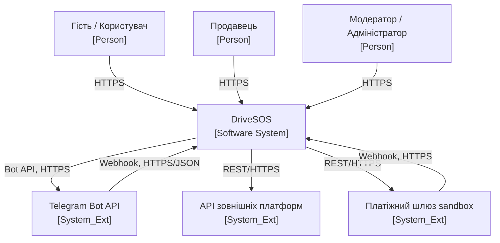
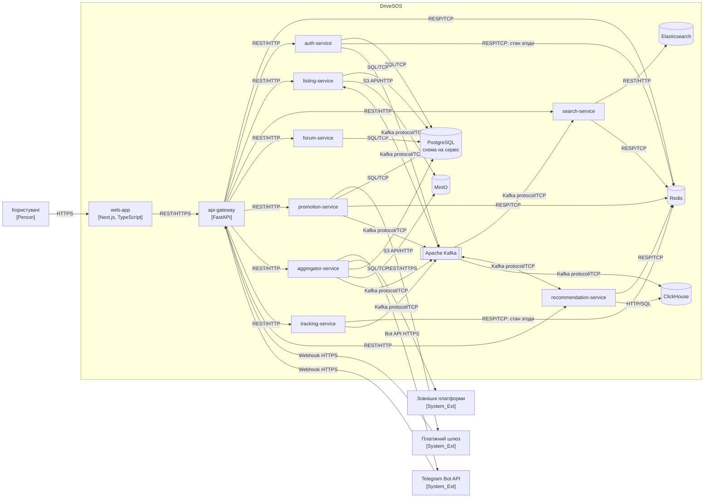
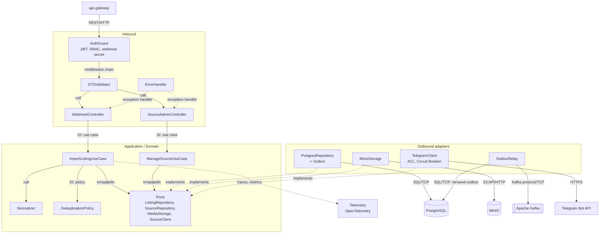

# РОЗДІЛ 2. ПРОЄКТУВАННЯ СИСТЕМИ

Вимоги: [SRS](./srs.md). Рішення: [ADR-001](./adr/0001-choice-of-technology.md).

## 2.1 Контекстне та контейнерне моделювання системи (C4 Model)

### Level 1: System Context

DriveSOS взаємодіє з трьома ролями користувачів (гість і користувач, продавець, модератор і адміністратор) та трьома зовнішніми системами. Користувачі працюють через HTTPS. Telegram надсилає повідомлення webhook-запитом, платіжний шлюз — результат оплати. Трасування: [SRS-FUN-11](./srs.md#srs-fun-11), [SRS-FUN-12](./srs.md#srs-fun-12).

### Level 2: Container

| Контейнер | Відповідальність | Вимоги |
|---|---|---|
| web-app | інтерфейс користувача | [SRS-FUN-04](./srs.md#srs-fun-04), [SRS-FUN-06](./srs.md#srs-fun-06), [SRS-FUN-07](./srs.md#srs-fun-07) |
| api-gateway | маршрутизація, Rate Limiting | [SRS-FUN-03](./srs.md#srs-fun-03) |
| auth-service | автентифікація, ролі, згода, видалення даних | [SRS-FUN-01](./srs.md#srs-fun-01), [SRS-FUN-02](./srs.md#srs-fun-02), [SRS-FUN-17](./srs.md#srs-fun-17), [SRS-FUN-18](./srs.md#srs-fun-18), [SRS-FUN-26](./srs.md#srs-fun-26) |
| listing-service | оголошення та медіафайли | [SRS-FUN-04](./srs.md#srs-fun-04), [SRS-FUN-05](./srs.md#srs-fun-05), [SRS-FUN-23](./srs.md#srs-fun-23), [SRS-FUN-24](./srs.md#srs-fun-24) |
| search-service | пошук і ранжування | [SRS-FUN-06](./srs.md#srs-fun-06), [SRS-FUN-10](./srs.md#srs-fun-10) |
| forum-service | теми, коментарі, скарги | [SRS-FUN-07](./srs.md#srs-fun-07), [SRS-FUN-08](./srs.md#srs-fun-08), [SRS-FUN-25](./srs.md#srs-fun-25) |
| promotion-service | кампанії та оплата | [SRS-FUN-09](./srs.md#srs-fun-09), [SRS-FUN-11](./srs.md#srs-fun-11), [SRS-FUN-21](./srs.md#srs-fun-21), [SRS-FUN-27](./srs.md#srs-fun-27) |
| aggregator-service | імпорт, нормалізація, дедуплікація | [SRS-FUN-12](./srs.md#srs-fun-12), [SRS-FUN-13](./srs.md#srs-fun-13), [SRS-FUN-14](./srs.md#srs-fun-14), [SRS-FUN-22](./srs.md#srs-fun-22) |
| tracking-service | прийом поведінкових подій | [SRS-FUN-15](./srs.md#srs-fun-15) |
| recommendation-service | персональний добір | [SRS-FUN-16](./srs.md#srs-fun-16) |
| Apache Kafka | подієва взаємодія ([ADR-001](./adr/0001-choice-of-technology.md)) | [SRS-FUN-19](./srs.md#srs-fun-19), [SRS-FUN-20](./srs.md#srs-fun-20) |

Сховища: PostgreSQL — транзакційні дані (окрема схема на сервіс), Redis — кеш, лічильники та стан згоди, Elasticsearch — пошуковий індекс, ClickHouse — аналітика подій, MinIO — медіафайли. Протоколи вказано на кожному зв'язку: HTTPS для зовнішнього трафіку, REST/HTTP усередині кластера, SQL/TCP, RESP/TCP, S3 API/HTTP, Kafka protocol/TCP. Усі сервіси експортують телеметрію за OTLP/gRPC до OpenTelemetry Collector; ці зв'язки та перевірку JWT за відкритим ключем у кожному сервісі не показано, щоб не перевантажувати схему.

## 2.2 Компонентне моделювання критичного сервісу системи

Обрано `aggregator-service`: він обробляє неструктуровані зовнішні дані та виконує дедуплікацію.

| Компонент | Роль |
|---|---|
| AuthGuard | перевірка секрету webhook або JWT і ролі адміністратора ([SRS-FUN-02](./srs.md#srs-fun-02)) |
| DTOValidator, ErrorHandler | валідація вхідних даних, уніфікована обробка помилок |
| WebhookController, SourceAdminController | вхідні адаптери без бізнес-логіки |
| ImportListingUseCase | сценарій імпорту ([SRS-FUN-12](./srs.md#srs-fun-12)) |
| ManageSourceUseCase | керування дозволеними джерелами |
| Normalizer | приведення до єдиної схеми ([SRS-FUN-13](./srs.md#srs-fun-13)) |
| DeduplicationPolicy | VIN, хеш фото, текстова схожість ([SRS-FUN-14](./srs.md#srs-fun-14)) |
| Ports | абстракції, від яких залежить ядро (Dependency Inversion, Dependency Injection) |
| PostgresRepository, OutboxRelay | атомарний запис і публікація `ListingImported` ([ADR-001](./adr/0001-choice-of-technology.md)) |
| MinioStorage, TelegramClient | адаптери сховища фото та зовнішнього API |
| Telemetry | трасування й метрики |

## 2.3 Документування архітектурних рішень

- [ADR-001: Вибір брокера повідомлень](./adr/0001-choice-of-technology.md)

## Висновки до розділу 2
