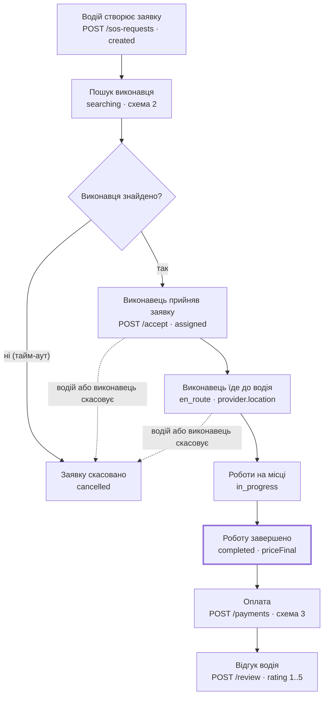
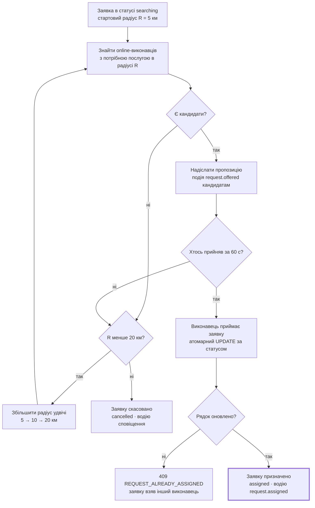
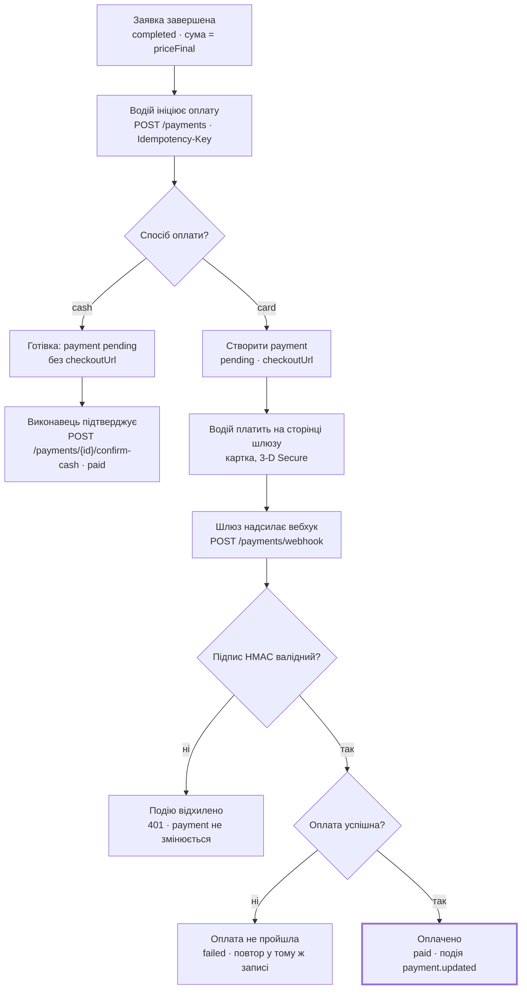

# 3-Flow Charts

Три блок-схеми описують ключові процеси DriveSOS: життєвий цикл заявки, пошук виконавця та оплату. Статуси та ендпоінти на схемах збігаються з [1-ERD](1-ERD.md) і [специфікацією контрактів](2-%D0%A1%D0%BF%D0%B5%D1%86%D0%B8%D1%84%D1%96%D0%BA%D0%B0%D1%86%D1%96%D1%8F%20%D0%BA%D0%BE%D0%BD%D1%82%D1%80%D0%B0%D0%BA%D1%82%D1%96%D0%B2.md).

## 1. Життєвий цикл SOS-заявки

SOS-заявку можна скасувати лише до початку робіт на місці.

Пунктирні лінії — скасування зі статусів `assigned` і `en_route`; після `in_progress` заявка може лише завершитися.

## 2. Пошук і призначення виконавця

Пошук розширює радіус до 20 км, а заявку отримує лише перший виконавець.

Якщо за 60 с ніхто не прийняв заявку, радіус подвоюється; другий виконавець, що натиснув «Прийняти», отримує 409. Радіус і тайм-аут — умовні значення.

## 3. Оплата

Картку підтверджує лише вебхук шлюзу з валідним підписом.

Готівку підтверджує виконавець через `POST /payments/{id}/confirm-cash`. Після `failed` повторна спроба оновлює той самий запис `payments`, бо `request_id` унікальний.
